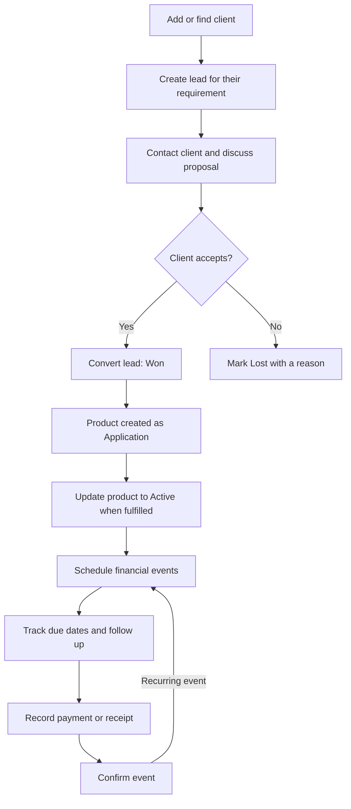

# Parvath FinServ CRM — Coworker Guide

Parvath FinServ CRM helps our team manage customers, track sales, and keep up with payments, renewals, and follow-ups.

You can introduce it to coworkers like this:

> This app keeps a customer’s details, financial products, sales enquiries, and pending work together. It helps us know who to contact, what they need, and what action is due next.

## 1. Understand the four main records

| Record | What it means | Example |
|---|---|---|
| Client | The person or business we work with | Ravi |
| Lead | A particular requirement or sales opportunity | Ravi wants health insurance |
| Product | The policy, loan, or investment linked to that client | Ravi’s health insurance policy |
| Follow-up | An action someone on our team must take | Call Ravi tomorrow |

One client can have several leads and several products. Reuse their existing client record when they need another service.

## 2. The main business flow

Existing policies or accounts can also be added directly as client products.

## 3. Walk through a customer example

Imagine **Ravi contacts us for health insurance**.

1. **Open Clients.** Search for Ravi first. If he is new, add his details. The app checks for duplicate phone numbers and email addresses.
2. **Create a Lead.** Link it to Ravi, describe his requirement, assign the responsible adviser, and enter the next action.
3. **Track the discussion.** Move the lead through stages such as New Enquiries, Contacted, and Proposal / Discussion. Schedule follow-ups as needed.
4. **Record acceptance.** Use the conversion action when Ravi accepts. This marks the lead Won and creates a linked product with **Application** status.
5. **Complete fulfilment.** Update the product to **Active** when the policy or account is actually active. Winning a sale and activating a product are separate steps.
6. **Schedule the premium or renewal.** Enter its due date, amount, and recurrence if applicable.
7. **Record the payment.** For a ₹12,000 event, recording ₹5,000 leaves ₹7,000 outstanding.
8. **Confirm after full payment.** Recording payment and confirming the event are separate actions. Confirmation creates the next event if recurrence is configured.

The CRM records payments entered by staff; that action does not itself transfer money.

## 4. What each screen is for

| Screen | How coworkers use it |
|---|---|
| Dashboard | Start the day: review upcoming financial events, overdue work, and recent activity |
| Clients | Find customers and open their profile, products, documents, notes, and communication history |
| Leads | Track enquiries and sales progress |
| Products | View available plans and client policy/account records |
| Providers | Manage companies supplying the plans |
| Renewals | Track financial due dates, payments, and confirmations |
| Follow-ups | Assign calls, meetings, emails, or WhatsApp actions and record outcomes |
| Calendar | Review scheduled work by date |
| WhatsApp | Prepare communication and record manual outcomes |
| Reports | Review operational information and export permitted data |
| Settings | Manage account and workspace options according to role |

**Renewals includes more than insurance renewals:** it also handles premium payments, loan instalments, loan reviews, interest, and maturity events.

## 5. The daily routine

> Start on the Dashboard. Check overdue and today’s work. Open the client before contacting them. After the conversation, record the outcome and schedule the next action. Update the lead if the sale progresses. For financial events, record the payment and then confirm once the full amount is covered.

When completing a follow-up, staff can record outcomes such as **Connected, No answer, Documents requested, or Meeting arranged**, and schedule another follow-up.

## 6. Who can do what

- **Administrator:** manages the workspace, members, catalogue, and business records.
- **Adviser:** manages clients, leads, products, financial events, and follow-ups.
- **Operations:** handles follow-ups, payment recording, confirmations, documents, and communication logs, with restrictions on editing clients and sales records.

Workspace members can view shared customer records. The assigned owner identifies who is responsible for the work.

## 7. Details to mention during the demo

- WhatsApp/email delivery is not automated in the current implementation.
- Document uploads require configured storage and scanning.
- Recording a payment and confirming a financial event are separate actions.
- A Won lead creates a product Application; fulfilment determines when it becomes Active.

## 8. Suggested presentation order

**Dashboard → Client → Lead → Product → Renewal → Follow-up**

Use Ravi’s example throughout to tell one complete customer story.

## Reference

These flows are based on the current application source and the [architecture and permissions guide](architecture.md).
